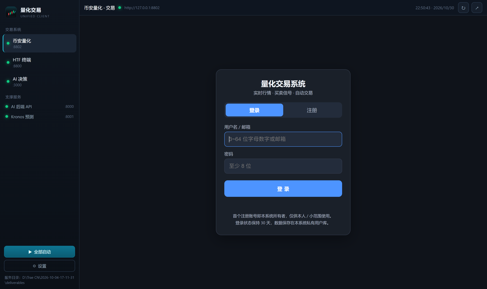

# 量化交易统一客户端 (Quant Trading Client)

把本地运行的多个量化系统聚合到一个桌面窗口里，**一个窗口自由切换**，并内置服务启动器与状态监控。

> 各业务系统仍然独立运行、互不影响。客户端只负责「聚合入口 + 启动管理」，不改动任何业务代码。

## 功能

- **多系统切换**：左侧列表切换 币安量化 / HTF 型态终端 / AI 决策端，各自独立登录态（`partition` 隔离）
- **服务状态监控**：8 秒轮询端口，绿点在线 / 红点离线，并常驻显示附属服务（AI 后端 8000、Kronos 8001）
- **一键启动**：页面离线时显示遮罩与启动按钮，点击即按对应命令拉起服务（Python / `docker compose`），启动后自动轮询到就绪并加载
- **全部启动**：侧栏一键拉起三个主系统
- **独立窗口 / 浏览器打开 · 刷新 · 全屏 · 日志查看**
- **服务目录可配置**：客户端不含业务代码，指向你的 `deliverables` 目录即可（首次启动会自动探测常见路径）
- **系统托盘**：关闭窗口后可从托盘召回

## 界面



```
┌──────────────┬────────────────────────────────────────────┐
│ 量化交易      │ 币安量化 · 交易  ●  http://127.0.0.1:8802   │
│ UNIFIED      ├────────────────────────────────────────────┤
│              │                                            │
│ 交易系统      │                                            │
│ ● 币安量化    │            （内嵌的系统页面）                │
│ ● HTF 终端    │                                            │
│ ● AI 决策     │                                            │
│              │                                            │
│ 支撑服务      │                                            │
│ ● AI 后端 API │                                            │
│ ● Kronos     │                                            │
│              │                                            │
│ [▶ 全部启动]  │                                            │
│ [⚙ 设置]      │                                            │
└──────────────┴────────────────────────────────────────────┘
```

## 快速开始

### 直接使用（已发布版本）

到 [Releases](../../releases) 下载：

| 文件 | 说明 |
|---|---|
| `QuantTradingClient-<版本>-x64.exe` | 安装版（可选安装路径，自动创建桌面快捷方式） |
| `QuantTradingClient-<版本>-portable.exe` | 免安装绿色版，双击即用 |

双击打开后，若提示「未找到服务目录」，点侧栏 **设置 → 选择目录…**，选中你本机的 `deliverables` 目录（其下应有 `binance-quant`、`htf/webapp`、`ai_engines`）。

### 从源码运行

```bash
npm install
npm start
```

要求：Node.js ≥ 18、Python 3（业务系统依赖）、Docker Desktop（AI 决策端依赖）。

## 打包

```bash
# 标准打包（CI / 有符号链接权限的 Windows 环境）
npm run dist

# 本地 Windows（普通用户权限）打包：跳过 winCodeSign 解压
npm run dist:local

# 仅生成便携版
npm run dist:portable

# 重新生成图标（需要 Python + Pillow）
npm run icon
```

产物在 `dist/`：

- `QuantTradingClient-<版本>-x64.exe` —— NSIS 安装包
- `QuantTradingClient-<版本>-portable.exe` —— 免安装便携版
- `win-unpacked/` —— 解包目录（可直接运行，用于调试）

### 关于 `dist:local`

electron-builder 在 Windows 上会下载 `winCodeSign` 包，包内包含 **macOS 的符号链接**（`darwin/*/lib/libcrypto.dylib`）。普通用户没有创建符号链接的权限，解压会报：

```
ERROR: Cannot create symbolic link : 客户端没有所需的特权
```

`dist:local` 通过 `-c.win.signAndEditExecutable=false` 跳过该步骤，从而正常出包。副作用是**应用 exe 使用 Electron 默认图标**（安装包自身的图标仍是 `build/icon.ico`，因为 NSIS 阶段直接读 ico 文件）。

在 CI（GitHub Actions 的 `windows-latest`）上使用 `npm run dist`，权限充足，会自动注入图标与版本信息，产出的包是完整的。

> 想本地也带图标：Windows 设置 → 隐私和安全性 → 开发者选项 → 打开「开发人员模式」（允许非管理员创建符号链接），之后 `npm run dist` 即可。

## 发布到 GitHub

1. 新建仓库并推送（见下节），仓库里包含 `.github/workflows/release.yml`
2. 打 tag 触发自动构建 + 自动发布 Release：

```bash
git tag v1.0.0
git push origin v1.0.0
```

工作流会在 `windows-latest` 上：

- `npm ci` → `npm run dist`（同时产出 `nsis` 安装包与 `portable` 绿色版）
- 上传构建产物为 Artifact
- 命中 `v*` tag 时自动创建 Release，并把 `.exe` 挂到 Release 供下载

也可以手动触发：仓库 **Actions → Build & Release → Run workflow**。

### 首次推送到 GitHub

```bash
cd desktop-client
git init
git add .
git commit -m "feat: 量化交易统一客户端 v1.0.0"
git branch -M main
git remote add origin https://github.com/<你的用户名>/<仓库名>.git
git push -u origin main
```

## 服务与端口约定

| 系统 | 端口 | 启动命令 |
|---|---|---|
| 币安量化 | 8802 | `cd deliverables/binance-quant && python app.py` |
| HTF 型态终端 | 8800 | `cd deliverables/htf/webapp && python app.py` |
| AI 决策端（前端） | 3000 | `cd deliverables/ai_engines/tradingagents && docker compose up -d` |
| AI 后端 API | 8000 | 同上（随 compose 启动） |
| Kronos 预测服务 | 8001 | `python -m uvicorn app:app --host 0.0.0.0 --port 8001` |

端口可在 `main.js` 顶部的 `SERVICES` / `EXTRAS` 中修改，`renderer/app.js` 顶部的 `MAIN` / `EXTRA` 需同步。

## 目录结构

```
desktop-client/
├── main.js                 主进程：窗口、菜单、托盘、端口探测、服务启动、IPC
├── preload.js              contextBridge 安全桥
├── renderer/
│   ├── index.html          界面结构
│   ├── styles.css          深色主题样式
│   └── app.js              视图切换、状态轮询、启动交互
├── build/
│   ├── icon.png            512×512 应用图标
│   ├── icon.ico            多尺寸 Windows 图标
│   └── tray.png            托盘图标
├── tools/make_icon.py      图标生成脚本（Pillow 绘制）
├── .github/workflows/release.yml
├── .npmrc                  npm / Electron 国内镜像
└── package.json
```

## 常见问题

**Q：提示「未找到服务代码目录」？**
客户端不打包业务代码（体积与授权原因），需在 **设置** 中指定 `deliverables` 目录。程序会自动尝试 `QUANT_SERVICES_ROOT` 环境变量、exe 同级 `deliverables`、同级目录、`文档/deliverables` 等位置。

**Q：点「启动」后一直转圈？**
服务启动是「下发命令 + 轮询端口」模式。超时请点 **查看日志**，日志在 `%APPDATA%/量化交易客户端/logs/<服务>.log`。

**Q：Python 命令不是 `python`？**
设置环境变量 `QUANT_PYTHON=py`（或你的解释器绝对路径）后再启动客户端。

**Q：切换系统后要重新登录？**
不会。每个系统使用独立的 `persist:` partition，登录态持久化保存在本地。

**Q：能否加更多系统？**
在 `main.js` 的 `SERVICES` 和 `renderer/app.js` 的 `MAIN` 中各加一项即可，界面自动生成。

## 安全说明

- `contextIsolation: true`、`nodeIntegration: false`，渲染层只能通过 `preload.js` 暴露的有限 API 与主进程通信
- 外部链接一律交给系统浏览器，不在内嵌视图里打开
- 客户端不保存任何交易所 API Key；凭证仍由各业务系统自行管理

## License

MIT
